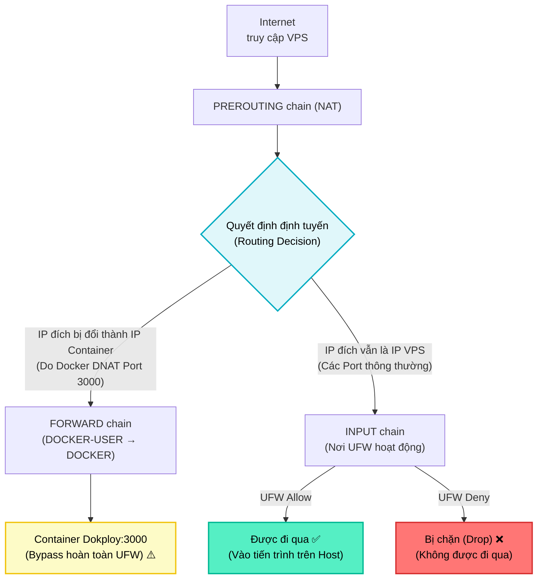

# Cloudflare (DNS01) -> Dokploy -> Docker

Mô hình này là kiến trúc triển khai web server hiện đại sử dụng Dokploy (một mã nguồn mở PaaS thay thế Vercel/Heroku) kết hợp cùng Cloudflare để tự động hoá việc triển khai ứng dụng và quản lý SSL. Dưới đây là vai trò của từng thành phần trong "combo" này:

### 1. Cloudflare (Xác thực DNS-01 & Quản lý DNS)

- **Vai trò:** Quản lý tên miền (DNS) và cung cấp phương thức xác thực quyền sở hữu tên miền để cấp SSL thông qua API.
- **Sức mạnh của DNS-01:** Khác với cách truyền thống (HTTP-01) yêu cầu server phải mở port 80 ra internet để Let's Encrypt gọi vào kiểm tra, phương thức **DNS-01** xác thực bằng cách tạo một bản ghi TXT ngầm trên DNS.
  - **Hỗ trợ Wildcard SSL:** Cho phép xin chứng chỉ `*.domain.com` dùng chung cho tất cả subdomain một cách dễ dàng thông qua Dokploy.
  - **Bảo mật & Ẩn danh:** Kết hợp với Cloudflare Proxy (đám mây màu cam), IP thật của VPS được giấu kín. Quá trình xác thực SSL diễn ra qua API mà không cần mở trực tiếp traffic vào server từ mọi nơi.

### 2. Dokploy (PaaS / Reverse Proxy / Tự động hoá)

- **Vai trò:** Hoạt động như một nền tảng quản lý triển khai (Platform as a Service). Nó thay thế hoàn toàn việc phải cấu hình thủ công Nginx, Certbot hay các file docker-compose phức tạp.
- **Hoạt động:**
  - **Quản lý SSL:** Dokploy (được tích hợp sẵn Traefik/Caddy) hỗ trợ kết nối trực tiếp với API của Cloudflare để tự động thực hiện quá trình DNS-01 Challenge, xin cấp và gia hạn chứng chỉ SSL tự động.
  - **Routing (Điều hướng):** Reverse Proxy bên trong Dokploy đóng vai trò như cửa ngõ, nhận luồng HTTPS từ người dùng (đã qua Cloudflare), giải mã SSL và điều hướng chính xác vào các ứng dụng tương ứng (Backend, Frontend) dựa theo domain.
  - **Triển khai ứng dụng:** Cung cấp giao diện quản trị (UI) trực quan để kết nối với Github/Gitlab, tự động build và deploy ứng dụng (CI/CD) chỉ với vài cú click.

### 3. Docker (Containerization)

- **Vai trò:** Trái tim của toàn bộ hệ thống. Bản thân Dokploy được cài đặt và chạy dưới dạng Docker container, và tất cả các ứng dụng mà bạn deploy qua Dokploy cũng được chạy trong các Docker container độc lập.
- **Lợi ích:** Đảm bảo môi trường chạy ứng dụng được cách ly, ổn định. Bạn không cần phải cài Nodejs, Python, hay PHP trực tiếp lên VPS. Hệ thống giữ được sự sạch sẽ tối đa.

---

**💡 Tóm tắt luồng hoạt động thực tế:**
Người dùng truy cập `https://app.domain.com` ➔ Yêu cầu đi qua mạng lưới CDN/Proxy của Cloudflare ➔ Đi vào VPS thông qua port 443 ➔ Dokploy tiếp nhận request, đối chiếu với chứng chỉ SSL (đã được lấy tự động qua DNS-01) ➔ Dokploy điều hướng request vào đúng Docker Container đang chạy ứng dụng ➔ Ứng dụng xử lý và trả kết quả về theo luồng ngược lại.

---

# Setup Cloudflare + Dokploy + Docker

- Tài nguyên cần có:
  - 1 VPS (khuyến nghị tối thiểu 2GB RAM, 1 vCPU) có mở Port 80, 443.
  - 1 domain
  - Account Cloudflare

## 1. Setup Cloudflare, tạo API Token
- Login vào account Cloudflare
- Vào Domains -> Overview -> Add domain -> Connect a domain
- Domain name: `<your_domain.com>`
- Select Plan: Free -> Continue to activation
- Copy 2 nameservers của Cloudflare và set vào domain registrar. Chờ 1-2 phút để update.

- Vào Profile -> API Tokens -> Create token -> Custom token -> Get started
  - Token name: `<your_token_name>`
  - Permissions:
    - Zone / DNS / Read
    - Zone / DNS / Edit
  - Zone Resources:
    - Include / Specific zone / `<your_domain.com>`
  - Client IP Address Filtering (Tuỳ chọn):
    - Is in / `<VPS_IP>`
- **Copy Cloudflare API token** lưu lại để sau này nhập vào Dokploy setup DNS-01.

- Vào CF Home -> Domains -> Overview -> `<your_domain.com>`
  + DNS -> Records -> Add record (Cho trang quản trị Dokploy)
    - Type: **A**
    - Name: `dokploy` (hoặc tên bất kỳ bạn muốn dùng)
    - IPv4 address: `<VPS_IP>`
    - Proxy status: **DNS only** (Tắt đám mây màu cam tạm thời để dễ dàng cài đặt ban đầu và xin SSL)
  + Tiếp tục Add record (Để trỏ toàn bộ subdomain về VPS):
    - Type: **A**
    - Name: `*`
    - IPv4 address: `<VPS_IP>`
    - Proxy status: **DNS only**
  + Tiếp tục Add record (Để trỏ domain gốc về VPS):
    - Type: **A**
    - Name: `@`
    - IPv4 address: `<VPS_IP>`
    - Proxy status: **DNS only**
  + SSL/TLS -> Overview -> Configure SSL/TLS encryption
    - Encryption mode: **Full (strict)** hoặc **Automatic SSL/TLS**

## 2. Cài đặt Dokploy & Docker

Dokploy cung cấp script cài đặt tự động cực kỳ đơn giản (Script này sẽ tự động cài Docker luôn nếu VPS của bạn chưa có).

```bash
# Install Dokploy (including Docker if you don't have it):
curl -sSL https://dokploy.com/install.sh | sudo sh

# Add current user to docker group:
sudo usermod -aG docker $USER
```

Quá trình cài đặt mất khoảng vài phút. Khi hoàn tất, bạn có thể truy cập vào giao diện quản trị của Dokploy thông qua IP:
`http://<VPS_IP>:3000/register`

- Tiến hành thiết lập tài khoản Admin đầu tiên (First-time setup) -> Register button.
  + First Name
  + Last Name
  + Email
  + Password
  + Confirm Password
- Enable 2FA (optional - recommend) tại Settings -> Profile -> Enable 2FA
  + Password: <your_password>
  + Continue

## 3. Cấu hình Wildcard SSL (DNS-01) trên Dokploy

Để Dokploy (với Traefik bên dưới) tự động xin chứng chỉ Wildcard Let's Encrypt qua DNS-01 (Cloudflare), bạn cần cấu hình trực tiếp vào Traefik thay vì chỉ thao tác cơ bản trên UI. Có một số "Gotcha" cần lưu ý để tiến trình này không bị lỗi (Ví dụ: Traefik không tự issue Wildcard nếu không có request, lỗi timeout DNS nội bộ, v.v...).

### 3.1. Cấp quyền API cho Traefik Container
- Trên UI Dokploy: Vào **Settings** -> **Web Server** -> **Traefik** -> **Modify Environment** -> **UnLock** -> **Update**
- Thêm biến môi trường: `CF_DNS_API_TOKEN=<your_cloudflare_api_token>`
- Nhấn **Save**.

### 3.2. Cấu hình tĩnh (Static Config) cho Traefik
- Vẫn trong **Home** -> **Traefik File System** -> **traefik.yml** -> **UnLock** -> **Update**
```yaml
certificatesResolvers:
  letsencrypt:
    acme:
      email: <your_email@gmail.com>
      storage: /etc/dokploy/traefik/dynamic/acme.json
      dnsChallenge:
        provider: cloudflare
        propagation:
          disableANSChecks: true
          delayBeforeChecks: 120s
        resolvers:
          - "1.1.1.1:53"
          - "8.8.8.8:53"
```

### 3.3. Tạo Dynamic Router "Mồi" để kích hoạt xin Wildcard
Bản thân việc khai báo static config chưa đủ để Traefik chủ động đi xin Wildcard SSL. Ta cần tạo một router dynamic ảo để "claim" domain đó thông qua VPS Terminal:

```bash
sudo tee /etc/dokploy/traefik/dynamic/wildcard-bootstrap.yml > /dev/null <<'EOF'
http:
  routers:
    wildcard-bootstrap:
      rule: "Host(`<your_domain.com>`)"
      entryPoints:
        - websecure
      service: noop@internal
      tls:
        certResolver: letsencrypt
        domains:
          - main: <your_domain.com>
            sans:
              - "*.<your_domain.com>"
EOF
```
*(File này có tác dụng hot-reload tức thì. Service `noop@internal` chỉ là service bù nhìn, đảm bảo router tồn tại để Traefik tiến hành đi xin SSL).*

### 3.4. Reload Traefik (Bắt buộc)
- Trên UI Dokploy: Vào **Settings** -> **Web Server** -> **Traefik** -> **Reload**
- Đợi khoảng 2-3 phút (quá trình CF propagate), Traefik sẽ cấp phát thành công chứng chỉ Wildcard, và mọi ứng dụng deploy sau này trên Dokploy dùng subdomain của `<your_domain.com>` đều sẽ tự động có SSL hợp lệ.

```bash
# Check if certificate is issued, expect 2 certificates: {"main": "<your_domain.com>", "sans": ["*.<your_domain.com>"]}
sudo cat /etc/dokploy/traefik/dynamic/acme.json | jq '.letsencrypt.Certificates | length, .[].domain'

# Check if the certificate is served
echo | openssl s_client -connect localhost:443 -servername anything.<your_domain.com> 2>/dev/null \
  | openssl x509 -noout -subject -issuer -ext subjectAltName
```

## 4. Deploy thử một ứng dụng

- Vào **Projects** -> Tạo một Project mới (VD: `my-projects`).
- Từ **Projects** -> **Create Service** -> **Compose**
  - Name: nginx
- Bấm **Create**
- Tab **General** -> Section **Provider** -> **Raw** -> Edit docker compose file:
```yaml
services:
  nginx:
    image: "nginx"
    networks:
      - dokploy-network
    labels:
      - "traefik.enable=true"
      - "traefik.http.routers.nginx.rule=Host(`nginx.<your_domain.com>`)"
      - "traefik.http.routers.nginx.entrypoints=websecure"
      - "traefik.http.routers.nginx.tls.certresolver=letsencrypt"
      - "traefik.http.services.nginx.loadbalancer.server.port=80"

networks:
  dokploy-network:
    external: true

```
- **Save**
- Section **Deploy Settings** chọn **Deploy**

## 5. Bảo mật Port 3000 (Admin Dashboard)

> **Vấn đề:** Dokploy bind `0.0.0.0:3000` (Docker Swarm `mode=host`) → dashboard bị lộ thẳng ra internet qua `IP:3000`. Cần chặn đường này, vẫn truy cập được qua subdomain `dokploy.<your_domain.com>`.
> **Tham khảo chi tiết:** [Tại sao UFW vô tác dụng với Docker?](https://devops.vn/posts/tai-sao-ufw-vo-tac-dung-voi-docker/)

**"Có login rồi, không có tài khoản thì vào sao được?"** Login chỉ bảo vệ bước xác thực, không bảo vệ đường truyền hay code chạy trước khi xác thực:

| Đường tấn công | Vì sao login không chặn được |
|---|---|
| Nghe lén khi chính bạn login | `IP:3000` là HTTP thuần → password + session cookie đi plaintext qua Wi-Fi/router/ISP |
| Lỗ hổng pre-auth (0-day) | Trang login/API là attack surface; bot quét toàn IPv4 tìm Dokploy ở `:3000` trong vài giờ sau khi CVE công bố |
| Brute-force / credential stuffing | Không 2FA + password dùng lại |
| Chuỗi lỗi sau login | Dokploy từng có nhiều CVE command injection/RCE (CVSS 9.4) cần login; lấy được session từ các đường trên là lên root |

Dokploy điều khiển Docker socket → vào được panel ≈ root VPS (đọc mọi secret, DB, deploy image tuỳ ý). Admin panel không nên nằm public, kể cả khi có login.

> Sau khi đóng `:3000`: **đổi password** nếu từng login qua `http://IP:3000`, và bật 2FA.

**Vì sao UFW không chặn được `IP:3000`?**



→ UFW filter ở chain **INPUT**, còn Docker chèn DNAT ở **PREROUTING** (sớm hơn) → traffic vào container đi qua **FORWARD**, **bypass hoàn toàn** INPUT chain của UFW.

### 5.1. Bước 1 — Cấu hình Domain cho Admin Dashboard

> 💡 **Lưu ý:** Hãy chắc chắn bạn đã hoàn tất **Bước 3. Cấu hình Wildcard SSL (DNS-01) trên Dokploy** ở trên để đảm bảo cơ chế nhận diện subdomain động (dynamic subdomain) đã hoạt động trơn tru.

Thực hiện gán domain cho trang quản trị trực tiếp trên giao diện của Dokploy:

1. Truy cập vào **Settings** ➔ **Web Server** ➔ **Server Domain**
2. Khai báo các thông số như sau:
   - **Domain:** `dokploy.<your_domain.com>`
   - **Let's Encrypt Email:** `<your_email@your_domain.com>`
   - **HTTPS:** Bật (Switch On)
   - **Certificate Provider:** Let's Encrypt
3. Bấm **Save** để lưu và áp dụng thay đổi.

*Ngay lúc này, bạn đã có thể truy cập an toàn vào giao diện Dokploy thông qua link: `https://dokploy.<your_domain.com>`*

### 5.2. Bước 2 (khuyến nghị) — Tắt publish port 3000 bằng toggle có sẵn của Dokploy

Dokploy có sẵn tuỳ chọn này, không cần firewall. Toggle **chỉ bật được khi đang truy cập panel qua domain** (để tránh tự khoá mình ở ngoài).

1. Mở panel qua `https://dokploy.<your_domain.com>` (không dùng `IP:3000`).
2. **Settings** ➔ **Web Server** ➔ bật tuỳ chọn tắt port 3000. Service restart vài giây (có thể thấy `502` tạm thời).

Bản chất toggle là gỡ phần publish port của Swarm service; container vẫn chạy và Traefik vẫn gọi vào qua `dokploy-network`:

```bash
# Tương đương thủ công
docker service update --publish-rm "published=3000,target=3000,mode=host" dokploy

# Rollback nếu mất truy cập (SSH vào VPS)
docker service update --publish-add published=3000,target=3000,mode=host dokploy
```

**Verify:**
```bash
docker service inspect dokploy --format '{{json .Endpoint.Spec.Ports}}'   # expect: null
curl -I --max-time 5 http://<VPS_IP>:3000                                  # expect: timeout
curl -I https://dokploy.<your_domain.com>                                  # expect: 200
```

Docs: [Dokploy Web Server](https://docs.dokploy.com/docs/core/web-server) · [Issue #947](https://github.com/Dokploy/dokploy/issues/947)

### 5.3. Cách thay thế — Chặn `IP:3000` ở chain `DOCKER-USER`

Chỉ dùng khi không muốn gỡ publish port (ví dụ cần `:3000` từ mạng nội bộ). Gỡ publish ở 5.2 gọn hơn vì không phải duy trì iptables rule qua reboot.

```bash
# Detect external interface (KHÔNG hardcode eth0/ens3)
EXT_IF=$(ip -4 route show default | awk '{print $5; exit}')
echo "$EXT_IF"  # verify trước khi apply

# Block IPv4 — truy cập trực tiếp IP:3000 từ ngoài
sudo iptables -I DOCKER-USER -i $EXT_IF -p tcp --dport 3000 -j DROP

# Block IPv6 — Dokploy cũng bind [::]:3000
sudo ip6tables -I DOCKER-USER -i $EXT_IF -p tcp --dport 3000 -j DROP

# Persist qua reboot
sudo apt install -y iptables-persistent      # chọn Yes khi hỏi lưu rules hiện tại
sudo netfilter-persistent save
```

> ⚠️ **Bắt buộc scope `-i $EXT_IF`.** Rule trần `--dport 3000 -j DROP` (không có `-i`) **sẽ khớp cả traffic Traefik→dokploy nội bộ** (cùng container port 3000) → **vỡ subdomain**. Tại `DOCKER-USER`, packet đã qua DNAT nên `--dport` = **container port**; scope theo interface để chỉ chặn nguồn ngoài.

**Verify song song ngay sau apply:**
```bash
curl -I --max-time 5 http://<VPS_IP>:3000          # expect: timeout/refused (đã chặn)
curl -I https://dokploy.<your_domain.com>           # expect: 200 (subdomain vẫn sống)
```

**Rollback nếu subdomain vỡ:**
```bash
sudo iptables  -D DOCKER-USER -i $EXT_IF -p tcp --dport 3000 -j DROP
sudo ip6tables -D DOCKER-USER -i $EXT_IF -p tcp --dport 3000 -j DROP
```

## 6. Harden Traefik (Gateway)

Traefik là cổng vào duy nhất của mọi app → cấu hình mặc định/debug cần siết lại trước khi chạy production. Sửa trong **Traefik File System** ➔ `traefik.yml`:

| Key | Mặc định | Nên là | Rủi ro thật |
|---|---|---|---|
| `log.level` | `DEBUG` | `INFO` / `WARN` | Log debug có thể ghi header `Authorization`, `Cookie` → ai đọc được log là có token/session |
| `api.insecure` | `true` | `false` | Mở dashboard `:8080` không auth. Chỉ nguy hiểm nếu `:8080` được publish — kiểm tra bằng `docker ps --filter name=traefik --format '{{.Ports}}'` |

`traefik.yml` là **static config** → phải **restart** Traefik (Settings ➔ Web Server ➔ Traefik ➔ Reload), mọi site gián đoạn vài giây. File trong `dynamic/` thì hot-reload, không cần restart.

## 7. Chặn truy cập trực tiếp Origin — SSL mode vs Authenticated Origin Pulls (AOP)

> **Vấn đề:** Bật proxy cam chỉ giấu IP; ai biết IP VPS vẫn gọi thẳng `:443` (`curl --resolve <host>:443:<VPS_IP> https://<host>`) → bypass WAF, rate limit, Turnstile, CF Access.

### 7.1. Hai chặng, hai chiều kiểm tra

```
Browser ──(chặng 1)──► Cloudflare ──(chặng 2)──► Origin (Traefik)
          cert Edge của CF          ① CF kiểm tra cert của origin   ← SSL/TLS mode
                                    ② Origin kiểm tra cert của CF   ← AOP
```

**SSL/TLS mode** (①) chỉ quy định Cloudflare đối xử với cert của origin — trả lời "*CF có đang nói chuyện đúng server không*":

| Mode | Chặng 2 (CF → origin) |
|---|---|
| Off | Không HTTPS |
| Flexible | HTTP thuần (không mã hoá) |
| Full | HTTPS, CF **không verify** cert origin (self-signed cũng được) |
| **Full (strict)** | HTTPS, CF **verify** cert origin (Let's Encrypt / Origin CA) |

**AOP** (②) là chiều ngược lại: origin bắt Cloudflare trình client cert — trả lời "*người gọi tôi có đúng là Cloudflare (của tôi) không*". Bật Full (strict) **không** chặn được bypass; cần thêm AOP. Bật cả ① + ② = **mTLS** trên chặng 2.

### 7.2. Ba mức bảo vệ origin

| Mức | Cấu hình | Chặn được |
|---|---|---|
| 1 | Chỉ ① Full (strict) | Không chặn gọi thẳng origin |
| 2 | ① + ② dùng **cert chung của Cloudflare** | Request không đi qua Cloudflare. Nhưng cert dùng chung mọi account → người khác tạo zone trỏ về IP bạn vẫn qua được |
| 3 | ① + ② dùng **cert riêng** (zone-level) | Chỉ request đi qua **zone của bạn** — khuyến nghị |

Hai chiều dùng hai cert khác nhau: server cert (Let's Encrypt) cho ①, client cert (CF hoặc của bạn) cho ②.

### 7.3. Điều kiện trước khi bật

- Mọi record trỏ về VPS phải **Proxied** (đám mây cam). Record `DNS only` ở bước 1 chỉ là tạm thời — bật cam lại sau khi setup xong. Host nào còn `DNS only` sẽ bị chặn khi bật AOP.
- SSL/TLS mode = **Full (strict)** (AOP không chạy với Off/Flexible).
- Cert dùng **DNS-01** (bước 3) → không ảnh hưởng. TLS-ALPN-01 sẽ vỡ khi bật mTLS.

### 7.4. Setup (mức 3 — cert riêng)

Flow đã chạy thật, theo thứ tự **mềm → bật CF → cứng** để không có lúc nào site bị chặn.

**Bước 0 — Kiểm tra trước:** SSL/TLS mode = Full (strict); mọi record Proxied; các host trả 200. Với IdP (oidc-provider) `/` trả `404` là bình thường → health check bằng `/.well-known/openid-configuration`.

**Bước 1 — Tạo CA + client cert (trên máy local, KHÔNG tạo trên VPS):**

```bash
mkdir -p ~/aop && chmod 700 ~/aop && cd ~/aop
openssl req -x509 -newkey rsa:2048 -nodes -days 3650 \
  -subj "/CN=<your_domain.com> AOP CA" -keyout aop-ca.key -out aop-ca.pem
openssl req -newkey rsa:2048 -nodes \
  -subj "/CN=cloudflare-origin-pull" -keyout aop-client.key -out aop-client.csr
openssl x509 -req -in aop-client.csr -CA aop-ca.pem -CAkey aop-ca.key -CAcreateserial \
  -days 730 -out aop-client.pem
chmod 600 *.key
openssl verify -CAfile aop-ca.pem aop-client.pem     # expect: aop-client.pem: OK
```

| File | Ai giữ | Ghi chú |
|---|---|---|
| `aop-ca.pem` | VPS (Traefik) | Public, chỉ dùng để verify |
| `aop-client.pem` + `aop-client.key` | **Chỉ Cloudflare** | Lộ key → gắn vào Postman/curl là gọi thẳng IP được |
| `aop-ca.key` | **Chỉ bạn** (vault/offline) | Dùng lại khi ký cert mới; lộ → tự ký client cert hợp lệ |

Không tạo trên VPS: `/etc/dokploy/traefik/dynamic/` hiện trên UI Dokploy (Traefik File System) và nằm trong backup/snapshot.

**Bước 2 — Traefik chế độ mềm** (`VerifyClientCertIfGiven`: chỉ verify nếu client gửi cert → chưa chặn ai):

```bash
scp ~/aop/aop-ca.pem <vps>:/tmp/aop-ca.pem
# trên VPS
sudo mv /tmp/aop-ca.pem /etc/dokploy/traefik/dynamic/certificates/aop-ca.pem
sudo tee /etc/dokploy/traefik/dynamic/aop.yml > /dev/null <<'YAML'
tls:
  options:
    default:
      minVersion: VersionTLS12
      clientAuth:
        caFiles:
          - /etc/dokploy/traefik/dynamic/certificates/aop-ca.pem
        clientAuthType: VerifyClientCertIfGiven
YAML
docker exec dokploy-traefik ls /etc/dokploy/traefik/dynamic/certificates/aop-ca.pem   # container thấy file
```

Đặt tên `default` để mọi TLS router (kể cả router Dokploy tạo sau) đều bị áp. Khi hai router xung đột TLS option, Traefik fallback về `default` → vẫn giữ mTLS. File trong `dynamic/` hot-reload, không cần restart.

**Bước 3 — Upload client cert lên Cloudflare (chưa bật):**

1. **SSL/TLS** ➔ **Origin Server** ➔ tab **Authenticated Origin Pulls** ➔ mục **Zone-level** ➔ **Upload certificate**.
2. Certificate: `pbcopy < ~/aop/aop-client.pem` → dán. Private key: `pbcopy < ~/aop/aop-client.key` → dán. (Phải là **leaf cert**; upload CA sẽ lỗi `missing leaf certificate`.)
3. **Continue** ➔ **Done**, kiểm tra status **active**.

**Bước 4 — Bật AOP:** cùng trang, toggle **Zone-level** ➔ **On**. Traefik vẫn đang mềm → không ai bị chặn.

**Bước 5 — Chuyển Traefik sang cứng** (kèm auto-rollback nếu host nào không còn 200):

```bash
ssh <vps> 'sudo sed -i "s/VerifyClientCertIfGiven/RequireAndVerifyClientCert/" /etc/dokploy/traefik/dynamic/aop.yml'
sleep 8
fail=0
for u in https://<your_domain.com> https://dokploy.<your_domain.com> https://auth.<your_domain.com>/.well-known/openid-configuration; do
  c=$(curl -s -o /dev/null -w '%{http_code}' --max-time 8 "$u"); echo "$u $c"; [ "$c" = 200 ] || fail=1
done
[ $fail = 1 ] && ssh <vps> 'sudo sed -i "s/RequireAndVerifyClientCert/VerifyClientCertIfGiven/" /etc/dokploy/traefik/dynamic/aop.yml' && echo ROLLED BACK
```

> ⚠️ **Thứ tự quan trọng:** bên gửi cert (CF, bước 4) bật trước, bên bắt buộc cert (Traefik, bước 5) bật sau. Làm ngược → toàn bộ site lỗi trong khoảng giữa hai bước.

**Bước 6 — Verify:**

```bash
for u in https://<your_domain.com> https://dokploy.<your_domain.com> https://auth.<your_domain.com>/.well-known/openid-configuration; do
  h=$(echo $u | cut -d/ -f3)
  echo "$h via CF   : $(curl -s -o /dev/null -w '%{http_code}' $u)"                                     # expect 200
  echo "$h direct IP: $(curl -s -o /dev/null -w '%{http_code}' --max-time 8 --resolve $h:443:<VPS_IP> $u)"  # expect 000
done

# Chứng minh chặn là do cert (không phải mạng đứt) — chạy TRƯỚC khi xoá client key
curl -s -o /dev/null -w '%{http_code}\n' --cert ~/aop/aop-client.pem --key ~/aop/aop-client.key \
  --resolve auth.<your_domain.com>:443:<VPS_IP> https://auth.<your_domain.com>/.well-known/openid-configuration   # expect 200
```

`000` có thể do firewall chặn nhầm; lần gọi có cert ra `200` mới chứng minh Traefik đang lọc theo cert.

**Bước 7 — Dọn key:**

```bash
cd ~/aop && rm aop-client.key aop-client.csr aop-ca.srl    # CF đã giữ client key
```

Chuyển `aop-ca.key` vào password manager / USB offline rồi xoá khỏi máy (Desktop/Documents thường bị iCloud sync + Time Machine backup).

**Rollback:**

| Lỗi ở | Làm |
|---|---|
| Bước 2 / 5 | `sudo rm /etc/dokploy/traefik/dynamic/aop.yml` (hot-reload) |
| Bước 4 | Toggle Zone-level ➔ **Off** |

### 7.5. Vận hành

- **Gia hạn:** cert riêng không tự xoay. Đặt lịch nhắc trước hạn (ví dụ trên: 730 ngày; CF gửi mail nhắc trước 30 và 14 ngày). Xoay: ký cert mới bằng `aop-ca.key` → upload lên CF → xác nhận active → xoá cert cũ (chỉ nên để 1 cert active).
- **Port 80 không có mTLS:** đóng hẳn từ ngoài (xem §8). Nếu còn mở thì router HTTP chỉ được redirect sang HTTPS, không phục vụ nội dung.
- **Gọi nội bộ:** health check hay app trong VPS gọi `https://<host>` mà resolve về IP gốc sẽ bị chặn → trong cùng Docker network, gọi thẳng tên service.

Docs: [Cloudflare SSL modes](https://developers.cloudflare.com/ssl/origin-configuration/ssl-modes/) · [Cloudflare AOP](https://developers.cloudflare.com/ssl/origin-configuration/authenticated-origin-pull) · [AOP manage certificates](https://developers.cloudflare.com/ssl/origin-configuration/authenticated-origin-pull/set-up/manage-certificates) · [Traefik v3.6 TLS options](https://doc.traefik.io/traefik/v3.6/reference/routing-configuration/http/tls/tls-options/)

## 8. Đóng port 80 ở origin (khuyến nghị)

> **Vấn đề:** AOP chỉ bảo vệ `:443`. Gõ `http://<VPS_IP>` vẫn tới Traefik ở `:80` → trả `404 page not found` (hoặc `301` cho host có router HTTP). Không lộ nội dung app, nhưng vẫn fingerprint được Traefik và là một đường vào không qua Cloudflare.

**Vì sao đóng được mà không vỡ gì:**

- User gõ `http://<host>` → **Cloudflare edge** tự trả `301 → https` (`Server: cloudflare`), request không xuống origin. Kiểm tra: `curl -sI http://<host> | grep -i ^server` phải ra `cloudflare`. Nếu chưa, bật **SSL/TLS ➔ Edge Certificates ➔ Always Use HTTPS** trước — ở mode Full, CF đi xuống origin theo scheme của visitor, nên thiếu bước này mà đóng `:80` sẽ gây lỗi `52x` cho visitor dùng `http://`.
- SSL mode Full (strict) → CF luôn kết nối origin qua `:443`.
- Cert lấy qua **DNS-01** → Let's Encrypt không cần `:80`. (Nếu sau này thêm domain dùng HTTP-01 thì phải mở lại.)

**Không sửa Traefik/Dokploy:** port `80:80` do Dokploy quản lý container Traefik, router HTTP trong `dynamic/dokploy.yml` do Dokploy sinh ra → sửa tay sẽ bị ghi đè. Chặn ở `DOCKER-USER` (giống §5.3) bền hơn.

**Apply + persist** bằng systemd unit idempotent (không dùng `iptables-persistent`: `netfilter-persistent save` lưu cả rule Docker tự sinh, restore lúc boot dễ lệch với Docker):

```bash
sudo tee /usr/local/sbin/docker-user-rules.sh > /dev/null <<'SH'
#!/bin/sh
set -e
EXT_IF=$(ip -4 route show default | awk '{print $5; exit}')
for ipt in iptables ip6tables; do
  $ipt -N DOCKER-USER 2>/dev/null || true
  $ipt -C DOCKER-USER -i "$EXT_IF" -p tcp --dport 80 -j DROP 2>/dev/null \
    || $ipt -I DOCKER-USER -i "$EXT_IF" -p tcp --dport 80 -j DROP
done
SH
sudo chmod 755 /usr/local/sbin/docker-user-rules.sh

sudo tee /etc/systemd/system/docker-user-rules.service > /dev/null <<'UNIT'
[Unit]
Description=Drop external traffic to published port 80 (origin only reachable via Cloudflare on 443)
After=docker.service
Requires=docker.service
PartOf=docker.service

[Service]
Type=oneshot
ExecStart=/usr/local/sbin/docker-user-rules.sh
RemainAfterExit=yes

[Install]
WantedBy=docker.service
UNIT

sudo systemctl daemon-reload
sudo systemctl enable --now docker-user-rules.service
```

`-C ... || -I ...` → chạy lại bao nhiêu lần cũng chỉ có 1 rule. `PartOf`/`WantedBy=docker.service` → Docker restart hay reboot đều áp lại. Scope `-i $EXT_IF` vì lý do như §5.3 (không chặn traffic nội bộ giữa container).

**Verify:**

```bash
sudo iptables -S DOCKER-USER; sudo ip6tables -S DOCKER-USER     # có rule --dport 80 -j DROP
curl -s -o /dev/null -w '%{http_code}\n' --max-time 6 http://<VPS_IP>/       # expect 000
curl -s -o /dev/null -w '%{http_code}\n' http://<host>/                       # expect 301 (từ CF edge)
curl -s -o /dev/null -w '%{http_code}\n' https://<host>/                      # expect 200
```

**Rollback:**

```bash
sudo systemctl disable --now docker-user-rules.service
EXT_IF=$(ip -4 route show default | awk '{print $5; exit}')
sudo iptables  -D DOCKER-USER -i $EXT_IF -p tcp --dport 80 -j DROP
sudo ip6tables -D DOCKER-USER -i $EXT_IF -p tcp --dport 80 -j DROP
```

**Kết quả sau §5 + §7 + §8:** từ Internet, origin chỉ còn nhận `:443` có client cert của Cloudflare. `IP:3000` đã gỡ publish, `IP:80` drop, `IP:443` không có cert bị cắt ở TLS handshake.
