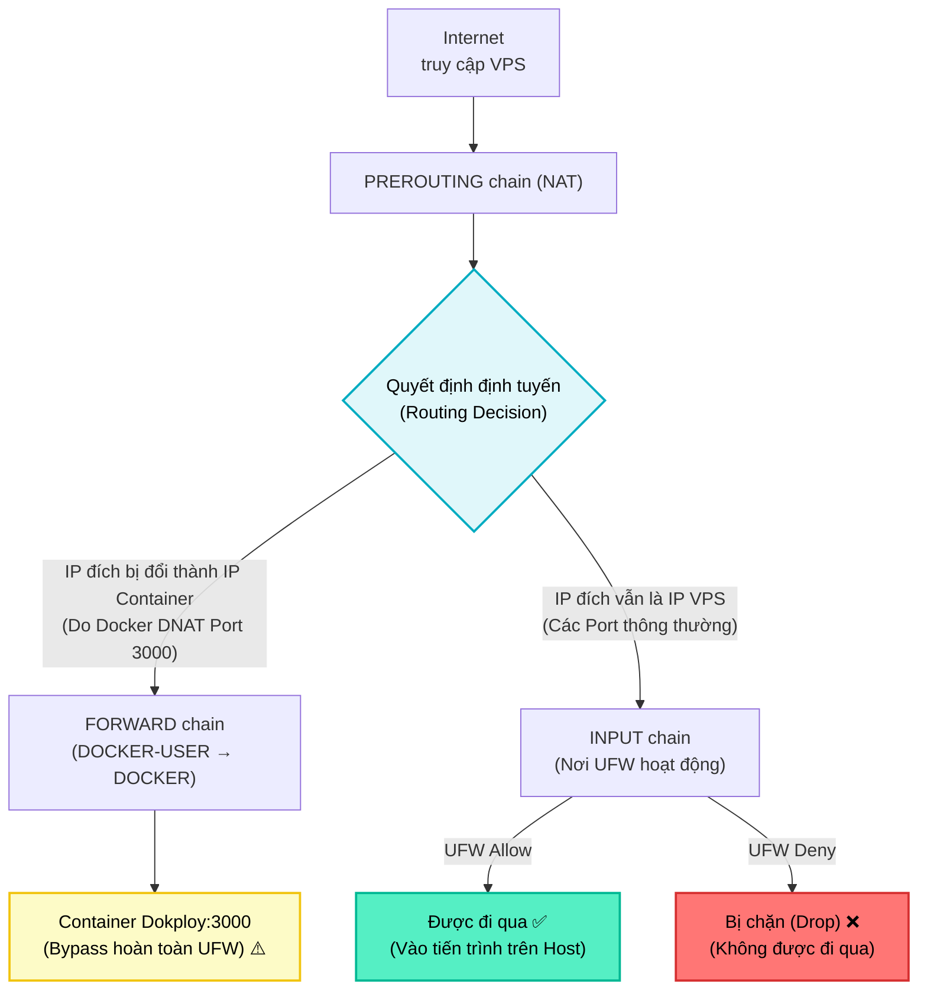

# Cloudflare (DNS01) -> Dokploy -> Docker

Mô hình này là kiến trúc triển khai web server hiện đại sử dụng Dokploy (một mã nguồn mở PaaS thay thế Vercel/Heroku) kết hợp cùng Cloudflare để tự động hoá việc triển khai ứng dụng và quản lý SSL. Dưới đây là vai trò của từng thành phần trong "combo" này:

### 1. Cloudflare (Xác thực DNS-01 & Quản lý DNS)

- **Vai trò:** Quản lý tên miền (DNS) và cung cấp phương thức xác thực quyền sở hữu tên miền để cấp SSL thông qua API.
- **Sức mạnh của DNS-01:** Khác với cách truyền thống (HTTP-01) yêu cầu server phải mở port 80 ra internet để Let's Encrypt gọi vào kiểm tra, phương thức **DNS-01** xác thực bằng cách tạo một bản ghi TXT ngầm trên DNS.
  - **Hỗ trợ Wildcard SSL:** Cho phép xin chứng chỉ `*.domain.com` dùng chung cho tất cả subdomain một cách dễ dàng thông qua Dokploy.
  - **Bảo mật & Ẩn danh:** Kết hợp với Cloudflare Proxy (đám mây màu cam), IP thật của VPS được giấu kín. Quá trình xác thực SSL diễn ra qua API mà không cần mở trực tiếp traffic vào server từ mọi nơi.

### 2. Dokploy (PaaS / Reverse Proxy / Tự động hoá)

- **Vai trò:** Hoạt động như một nền tảng quản lý triển khai (Platform as a Service). Nó thay thế hoàn toàn việc phải cấu hình thủ công Nginx, Certbot hay các file docker-compose phức tạp.
- **Hoạt động:**
  - **Quản lý SSL:** Dokploy (được tích hợp sẵn Traefik/Caddy) hỗ trợ kết nối trực tiếp với API của Cloudflare để tự động thực hiện quá trình DNS-01 Challenge, xin cấp và gia hạn chứng chỉ SSL tự động.
  - **Routing (Điều hướng):** Reverse Proxy bên trong Dokploy đóng vai trò như cửa ngõ, nhận luồng HTTPS từ người dùng (đã qua Cloudflare), giải mã SSL và điều hướng chính xác vào các ứng dụng tương ứng (Backend, Frontend) dựa theo domain.
  - **Triển khai ứng dụng:** Cung cấp giao diện quản trị (UI) trực quan để kết nối với Github/Gitlab, tự động build và deploy ứng dụng (CI/CD) chỉ với vài cú click.

### 3. Docker (Containerization)

- **Vai trò:** Trái tim của toàn bộ hệ thống. Bản thân Dokploy được cài đặt và chạy dưới dạng Docker container, và tất cả các ứng dụng mà bạn deploy qua Dokploy cũng được chạy trong các Docker container độc lập.
- **Lợi ích:** Đảm bảo môi trường chạy ứng dụng được cách ly, ổn định. Bạn không cần phải cài Nodejs, Python, hay PHP trực tiếp lên VPS. Hệ thống giữ được sự sạch sẽ tối đa.

---

**💡 Tóm tắt luồng hoạt động thực tế:**
Người dùng truy cập `https://app.domain.com` ➔ Yêu cầu đi qua mạng lưới CDN/Proxy của Cloudflare ➔ Đi vào VPS thông qua port 443 ➔ Dokploy tiếp nhận request, đối chiếu với chứng chỉ SSL (đã được lấy tự động qua DNS-01) ➔ Dokploy điều hướng request vào đúng Docker Container đang chạy ứng dụng ➔ Ứng dụng xử lý và trả kết quả về theo luồng ngược lại.

---

# Setup Cloudflare + Dokploy + Docker

- Tài nguyên cần có:
  - 1 VPS (khuyến nghị tối thiểu 2GB RAM, 1 vCPU) có mở Port 80, 443.
  - 1 domain
  - Account Cloudflare

## 1. Setup Cloudflare, tạo API Token
- Login vào account Cloudflare
- Vào Domains -> Overview -> Add domain -> Connect a domain
- Domain name: `<your_domain.com>`
- Select Plan: Free -> Continue to activation
- Copy 2 nameservers của Cloudflare và set vào domain registrar. Chờ 1-2 phút để update.

- Vào Profile -> API Tokens -> Create token -> Custom token -> Get started
  - Token name: `<your_token_name>`
  - Permissions:
    - Zone / DNS / Read
    - Zone / DNS / Edit
  - Zone Resources:
    - Include / Specific zone / `<your_domain.com>`
  - Client IP Address Filtering (Tuỳ chọn):
    - Is in / `<VPS_IP>`
- **Copy Cloudflare API token** lưu lại để sau này nhập vào Dokploy setup DNS-01.

- Vào CF Home -> Domains -> Overview -> `<your_domain.com>`
  + DNS -> Records -> Add record (Cho trang quản trị Dokploy)
    - Type: **A**
    - Name: `dokploy` (hoặc tên bất kỳ bạn muốn dùng)
    - IPv4 address: `<VPS_IP>`
    - Proxy status: **DNS only** (Tắt đám mây màu cam tạm thời để dễ dàng cài đặt ban đầu và xin SSL)
  + Tiếp tục Add record (Để trỏ toàn bộ subdomain về VPS):
    - Type: **A**
    - Name: `*`
    - IPv4 address: `<VPS_IP>`
    - Proxy status: **DNS only**
  + Tiếp tục Add record (Để trỏ domain gốc về VPS):
    - Type: **A**
    - Name: `@`
    - IPv4 address: `<VPS_IP>`
    - Proxy status: **DNS only**
  + SSL/TLS -> Overview -> Configure SSL/TLS encryption
    - Encryption mode: **Full (strict)** hoặc **Automatic SSL/TLS**

## 2. Cài đặt Dokploy & Docker

Dokploy cung cấp script cài đặt tự động cực kỳ đơn giản (Script này sẽ tự động cài Docker luôn nếu VPS của bạn chưa có).

```bash
# Install Dokploy (including Docker if you don't have it):
curl -sSL https://dokploy.com/install.sh | sudo sh

# Add current user to docker group:
sudo usermod -aG docker $USER
```

Quá trình cài đặt mất khoảng vài phút. Khi hoàn tất, bạn có thể truy cập vào giao diện quản trị của Dokploy thông qua IP:
`http://<VPS_IP>:3000/register`

- Tiến hành thiết lập tài khoản Admin đầu tiên (First-time setup) -> Register button.
  + First Name
  + Last Name
  + Email
  + Password
  + Confirm Password
- Enable 2FA (optional - recommend) tại Settings -> Profile -> Enable 2FA
  + Password: <your_password>
  + Continue

## 3. Cấu hình Wildcard SSL (DNS-01) trên Dokploy

Để Dokploy (với Traefik bên dưới) tự động xin chứng chỉ Wildcard Let's Encrypt qua DNS-01 (Cloudflare), bạn cần cấu hình trực tiếp vào Traefik thay vì chỉ thao tác cơ bản trên UI. Có một số "Gotcha" cần lưu ý để tiến trình này không bị lỗi (Ví dụ: Traefik không tự issue Wildcard nếu không có request, lỗi timeout DNS nội bộ, v.v...).

### 3.1. Cấp quyền API cho Traefik Container
- Trên UI Dokploy: Vào **Settings** -> **Web Server** -> **Traefik** -> **Modify Environment** -> **UnLock** -> **Update**
- Thêm biến môi trường: `CF_DNS_API_TOKEN=<your_cloudflare_api_token>`
- Nhấn **Save**.

### 3.2. Cấu hình tĩnh (Static Config) cho Traefik
- Vẫn trong **Home** -> **Traefik File System** -> **traefik.yml** -> **UnLock** -> **Update**
```yaml
certificatesResolvers:
  letsencrypt:
    acme:
      email: <your_email@gmail.com>
      storage: /etc/dokploy/traefik/dynamic/acme.json
      dnsChallenge:
        provider: cloudflare
        propagation:
          disableANSChecks: true
          delayBeforeChecks: 120s
        resolvers:
          - "1.1.1.1:53"
          - "8.8.8.8:53"
```

### 3.3. Tạo Dynamic Router "Mồi" để kích hoạt xin Wildcard
Bản thân việc khai báo static config chưa đủ để Traefik chủ động đi xin Wildcard SSL. Ta cần tạo một router dynamic ảo để "claim" domain đó thông qua VPS Terminal:

```bash
sudo tee /etc/dokploy/traefik/dynamic/wildcard-bootstrap.yml > /dev/null <<'EOF'
http:
  routers:
    wildcard-bootstrap:
      rule: "Host(`<your_domain.com>`)"
      entryPoints:
        - websecure
      service: noop@internal
      tls:
        certResolver: letsencrypt
        domains:
          - main: <your_domain.com>
            sans:
              - "*.<your_domain.com>"
EOF
```
*(File này có tác dụng hot-reload tức thì. Service `noop@internal` chỉ là service bù nhìn, đảm bảo router tồn tại để Traefik tiến hành đi xin SSL).*

### 3.4. Reload Traefik (Bắt buộc)
- Trên UI Dokploy: Vào **Settings** -> **Web Server** -> **Traefik** -> **Reload**
- Đợi khoảng 2-3 phút (quá trình CF propagate), Traefik sẽ cấp phát thành công chứng chỉ Wildcard, và mọi ứng dụng deploy sau này trên Dokploy dùng subdomain của `<your_domain.com>` đều sẽ tự động có SSL hợp lệ.

```bash
# Check if certificate is issued, expect 2 certificates: {"main": "<your_domain.com>", "sans": ["*.<your_domain.com>"]}
sudo cat /etc/dokploy/traefik/dynamic/acme.json | jq '.letsencrypt.Certificates | length, .[].domain'

# Check if the certificate is served
echo | openssl s_client -connect localhost:443 -servername anything.<your_domain.com> 2>/dev/null \
  | openssl x509 -noout -subject -issuer -ext subjectAltName
```

## 4. Deploy thử một ứng dụng

- Vào **Projects** -> Tạo một Project mới (VD: `my-projects`).
- Từ **Projects** -> **Create Service** -> **Compose**
  - Name: nginx
- Bấm **Create**
- Tab **General** -> Section **Provider** -> **Raw** -> Edit docker compose file:
```yaml
services:
  nginx:
    image: "nginx"
    networks:
      - dokploy-network
    labels:
      - "traefik.enable=true"
      - "traefik.http.routers.nginx.rule=Host(`nginx.<your_domain.com>`)"
      - "traefik.http.routers.nginx.entrypoints=websecure"
      - "traefik.http.routers.nginx.tls.certresolver=letsencrypt"
      - "traefik.http.services.nginx.loadbalancer.server.port=80"

networks:
  dokploy-network:
    external: true

```
- **Save**
- Section **Deploy Settings** chọn **Deploy**

## 5. Bảo mật Port 3000 (Admin Dashboard)

> **Vấn đề:** Dokploy bind `0.0.0.0:3000` (Docker Swarm `mode=host`) → dashboard bị lộ thẳng ra internet qua `IP:3000`. Cần chặn đường này, vẫn truy cập được qua subdomain `dokploy.<your_domain.com>`.
> **Tham khảo chi tiết:** [Tại sao UFW vô tác dụng với Docker?](https://devops.vn/posts/tai-sao-ufw-vo-tac-dung-voi-docker/)

**Vì sao UFW không chặn được `IP:3000`?**



→ UFW filter ở chain **INPUT**, còn Docker chèn DNAT ở **PREROUTING** (sớm hơn) → traffic vào container đi qua **FORWARD**, **bypass hoàn toàn** INPUT chain của UFW.

### 5.1. Bước 1 — Cấu hình Domain cho Admin Dashboard

> 💡 **Lưu ý:** Hãy chắc chắn bạn đã hoàn tất **Bước 3. Cấu hình Wildcard SSL (DNS-01) trên Dokploy** ở trên để đảm bảo cơ chế nhận diện subdomain động (dynamic subdomain) đã hoạt động trơn tru.

Thực hiện gán domain cho trang quản trị trực tiếp trên giao diện của Dokploy:

1. Truy cập vào **Settings** ➔ **Web Server** ➔ **Server Domain**
2. Khai báo các thông số như sau:
   - **Domain:** `dokploy.<your_domain.com>`
   - **Let's Encrypt Email:** `<your_email@your_domain.com>`
   - **HTTPS:** Bật (Switch On)
   - **Certificate Provider:** Let's Encrypt
3. Bấm **Save** để lưu và áp dụng thay đổi.

*Ngay lúc này, bạn đã có thể truy cập an toàn vào giao diện Dokploy thông qua link: `https://dokploy.<your_domain.com>`*

### 5.2. Bước 2 — Chặn `IP:3000` ở chain `DOCKER-USER`

```bash
# Detect external interface (KHÔNG hardcode eth0/ens3)
EXT_IF=$(ip -4 route show default | awk '{print $5; exit}')
echo "$EXT_IF"  # verify trước khi apply

# Block IPv4 — truy cập trực tiếp IP:3000 từ ngoài
sudo iptables -I DOCKER-USER -i $EXT_IF -p tcp --dport 3000 -j DROP

# Block IPv6 — Dokploy cũng bind [::]:3000
sudo ip6tables -I DOCKER-USER -i $EXT_IF -p tcp --dport 3000 -j DROP

# Persist qua reboot
sudo apt install -y iptables-persistent      # chọn Yes khi hỏi lưu rules hiện tại
sudo netfilter-persistent save
```

> ⚠️ **Bắt buộc scope `-i $EXT_IF`.** Rule trần `--dport 3000 -j DROP` (không có `-i`) **sẽ khớp cả traffic Traefik→dokploy nội bộ** (cùng container port 3000) → **vỡ subdomain**. Tại `DOCKER-USER`, packet đã qua DNAT nên `--dport` = **container port**; scope theo interface để chỉ chặn nguồn ngoài.

**Verify song song ngay sau apply:**
```bash
curl -I --max-time 5 http://<VPS_IP>:3000          # expect: timeout/refused (đã chặn)
curl -I https://dokploy.<your_domain.com>           # expect: 200 (subdomain vẫn sống)
```

**Rollback nếu subdomain vỡ:**
```bash
sudo iptables  -D DOCKER-USER -i $EXT_IF -p tcp --dport 3000 -j DROP
sudo ip6tables -D DOCKER-USER -i $EXT_IF -p tcp --dport 3000 -j DROP
```
